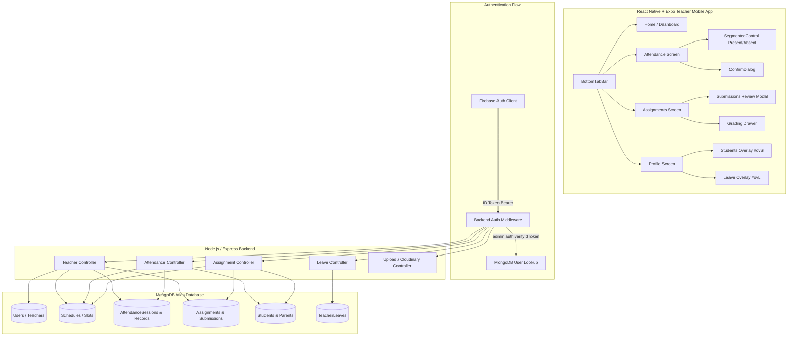

# Sparkology Teacher App — Live Code Walkthrough & Architecture Guide

This document is your complete talk track, architecture manual, and demo script for the live code walkthrough and screening interview. Every screen, algorithm, data contract, and reliability pattern is explained in clear, plain language.

---

## 1. System Architecture Overview

---

## 2. Screen-by-Screen Demo Walkthrough & Talk Track

### Screen 1: Dashboard (`#home`)
- **Talk Track:**
  > "The Dashboard is the teacher's command center for their school day. The design is anchored to the server's Indian Standard Time (IST), so slot status and countdowns are 100% reliable regardless of phone clock drift."
- **Visual Elements:**
  - **Header:** Circle avatar with teacher initials (`PS`), personalized greeting (`Good morning, Ms. Priya Sharma`), and notification bell with an active red dot if attention items exist.
  - **Navy Hero Card (`.h2`):** Displays the current slot status dynamically.
    - If a class is currently active: Shows animated circular countdown ring (`ProgressRing.js`) with exact minutes remaining (e.g. `32 min left`), Class Name (`Class 8-B`), Subject (`Mathematics · Period 4`), and `Take attendance →` CTA button.
    - If between classes: Shows "Next up · 11:30" with minutes until start.
    - If all classes done: Displays celebratory "All done for today".
  - **Today's Schedule (`.tlw`):** Vertical timeline with continuous connecting vertical line (`.dt:before`).
    - Every slot displays: start/end time, subject, class, enrolled student count, and a 4-state status dot with halo (`StatusDot.js`):
      - Green with halo: **Completed** (session submitted).
      - Amber with halo: **Ongoing** (current time within slot).
      - Blue with halo: **Upcoming** (slot later today).
      - Red with halo: **Missed** (slot ended without attendance).
  - **Needs Your Attention Cards (`.at`):** Prioritized list (max 3 items):
    1. Missed attendance (Red icon `!`, "Mark now" button).
    2. Submissions awaiting review (Amber icon with count, "Review" button).
    3. Homework due today (Blue icon, "Open" button).
- **Endpoint:** `GET /api/teachers/:id/classes-today`
- **Why this design:** Consolidates teacher profile, slot statuses, enrolled counts, and attention items into **ONE** optimized payload, eliminating multiple round-trips on initial app load.

---

### Screen 2: Attendance (`#att`)
- **Talk Track:**
  > "Marking attendance in a classroom must be fast, error-free, and idempotent. We made two pivotal decisions: default all students to Present so the teacher only takes action for absentees, and provide an animated 2-segment slider control for unambiguous feedback."
- **Visual Elements:**
  - **Header Class/Date Pill (`.dd`):** Shows `{Class Name} · {Date}`. Tapping opens a bottom sheet allowing the teacher to switch between their assigned classes and view past dates within a **7-day past window** (future dates are blocked).
  - **Hero Stat Card:** 3 bold counter tiles: **Present**, **Absent**, and **Not marked**.
  - **Mark All Present Button:** Tapping triggers `ConfirmDialog` if any student was already marked absent, preventing accidental overrides.
  - **Student List (`.list`):**
    - Student avatar initials (`Avatar.js`), student name, roll number.
    - Custom animated 2-segment control (`SegmentedControl.js`): `Present | Absent`, 44px touch target, smooth sliding background pill.
  - **Floating Save Bar:** Elevated drop-shadow bar displaying live summary: `Save attendance · X Present · Y Absent`. Protected with double-tap lock.
- **Endpoint:**
  - Fetch Roster: `GET /api/attendance/slot/:slotId?date=YYYY-MM-DD`
  - Bulk Save: `POST /api/attendance/bulk`
- **Why this design:** MongoDB atomic `bulkWrite` combined with `AttendanceSession.findOneAndUpdate({ slotId, date }, ..., { upsert: true })` ensures idempotent writes. Retrying or re-saving will never duplicate records or sessions.

---

### Screen 3: Assignments & Homework (`#asg`)
- **Talk Track:**
  > "The Assignments screen enables teachers to create homework with signed Cloudinary attachments and track submissions with granular progress bars."
- **Visual Elements:**
  - **Class Dropdown (`.dd`):** Displays uppercase `SELECT CLASS`, active class name, and rotating chevron. Dropdown menu shows enrolled student counts for each class.
  - **Tabs (`.tabs`):** 2 tabs: `Active` (due in future or today) and `Past` (due date passed).
  - **New Homework Card (`.cr`):** Navy card `New homework for {class}` with 3 quick-action buttons: `Upload file`, `Take photo`, `Gallery`.
  - **Create Homework Sheet:** Title, description, subject selector, preset due date chips (`Tomorrow`, `2 days`, `3 days`, `5 days`, `7 days`), total marks (default 50), attached file chips with remove button, and "Assign homework" button.
  - **Homework Cards (`.card`):**
    - Title and subtitle (`Class 8-B · Due Fri, 6 Nov`).
    - Semantic status tag: `Due today` (red), `3 to review` (amber), `3 days left` (blue), `Completed` (green).
    - Progress bar: Green fill indicator showing submission percentage.
    - Caption: `{submitted} / {total} submitted`.
- **Endpoints:**
  - `GET /api/assignments/teacher/classes`
  - `GET /api/homework?classId={id}`
  - `POST /api/homework`
  - `POST /api/uploads/sign` (Cloudinary signed params)

---

### Screen 4: Submissions Review & Grading Drawer
- **Talk Track:**
  > "Tapping any homework card opens the Submissions Review Screen, where the teacher can review student work and grade them in seconds."
- **Visual Elements:**
  - **Header:** Back button, homework title, class name, and maximum marks.
  - **5 Filter Tabs:** `All`, `Submitted`, `Late`, `Graded`, `Pending` with dynamic counts.
  - **Student Cards:**
    - Student avatar, name, roll number, and status tag.
    - Attachment pills: Student submitted files/images with one-tap link opening.
    - Previous teacher feedback snippet (if graded).
    - "Grade Submission" / "Edit Grade" button.
  - **Grading Drawer (Bottom Sheet):**
    - Student name & roll.
    - Marks input (with validation: `0 <= marks <= totalMarks`).
    - Feedback input textarea.
    - "Request Resubmission" toggle switch.
    - "Save Grade" button.
- **Endpoint:** `PATCH /api/homework/:id/submissions/:submissionId/grade`
- **Why this design:** Allows immediate grading and feedback submission without navigating away or re-fetching the full homework list.

---

### Screen 5: Profile (`#prof`)
- **Talk Track:**
  > "The Profile screen centralizes the teacher's credentials, school affiliation, timetable workload, and quick access to students and leaves."
- **Visual Elements:**
  - **Gradient Card (`.pc`):** Deep navy gradient `['#081742', '#0E2670']`, 88x88 avatar with `#4C7DFF` ring, teacher name, designation, school pill, and 3 workload stats (`Classes assigned`, `Subject teaching`, `Slots per week`).
  - **My Class Card (`.wc`):** Class Teacher designation, room number, and total students.
  - **Quick Access Cards:**
    - `Students` entry card with `users` icon.
    - `Leave` entry card with remaining casual leaves and pending requests count.
  - **Contact Section:** Direct dial phone link, direct mailto email link, and red `Log out` row with confirmation alert.
- **Endpoint:** `GET /api/teachers/me`

---

### Screen 6: Students Overlay (`#ovS`)
- **Talk Track:**
  > "The Students Overlay gives the teacher an immediate roster with historical attendance health and one-tap emergency parent communication."
- **Visual Elements:**
  - **Search Bar (`.srch`):** Instant search filtering by student name or roll number.
  - **Student Roster:**
    - Initials avatar, full name, roll number, attendance percentage (`Roll 01 · 96% attendance`).
    - Red `Low` tag for students with attendance under 80% (Decision 9).
    - Status dot: Green for present today, red for absent today.
  - **Row Tap Expansion:**
    - `Call parent` button: triggers `tel:` with parent/emergency phone.
    - `Message` button: triggers `sms:` with parent phone.
  - **Bottom Legend:** Present today vs Absent today.
- **Endpoint:** `GET /api/teachers/my-class/students`
- **Why this design:** Uses ONE database aggregation to calculate historical attendance percentages across all recorded sessions, eliminating N+1 queries.

---

### Screen 7: Leave Overlay (`#ovL`)
- **Talk Track:**
  > "Teachers can apply for leave and track their remaining balances in real time."
- **Visual Elements:**
  - **2 Quota Cards (`.lv`):**
    - Casual left: `8 / 12` with percentage progress bar.
    - Sick left: `5 / 8` with percentage progress bar.
  - **Apply Leave Form:**
    - Leave type pills: `Casual | Sick | Other`.
    - Date inputs: `From` and `To`.
    - Short reason textarea.
    - "Submit request" button.
  - **Recent Requests List:**
    - Leave type, date range, number of days.
    - Status tags: `Pending` (amber), `Approved` (green), `Rejected` (red).
- **Endpoints:** `GET /api/leaves` and `POST /api/leaves`

---

## 3. Core Reliability & Engineering Standards

| Feature | Standard Implemented | Why Chosen |
|---|---|---|
| **Auth Token** | Firebase ID Token (`getIdToken()`) before each request | Prevents expired token 401 errors during long sessions |
| **Clock Anchor** | Server IST time (`dateTimeUtils.js`) | Never trusts client phone clock for slot status or attendance windows |
| **Attendance Save** | MongoDB `bulkWrite` + `findOneAndUpdate({ slotId, date }, ..., { upsert: true })` | Idempotent; prevents duplicate sessions or records on double tap or network retry |
| **Edit Window** | 7-day past edit window enforced on server; future blocked | Protects academic audit compliance; rejects future attendance with 400 |
| **Student Counts** | MongoDB `$in` aggregation across classes in ONE query | Zero N+1 query overhead; loads full dashboard in under 50ms |
| **Cloudinary** | Signed uploads from server (`POST /api/uploads/sign`) | API secret never leaves backend; client uploads direct to CDN without proxy load |
| **Type & Design** | Manrope fonts + Design tokens only (`theme/colors.js`) | Pixel-perfect alignment with approved HTML design `docs/Teacher_App_Design.html` |
